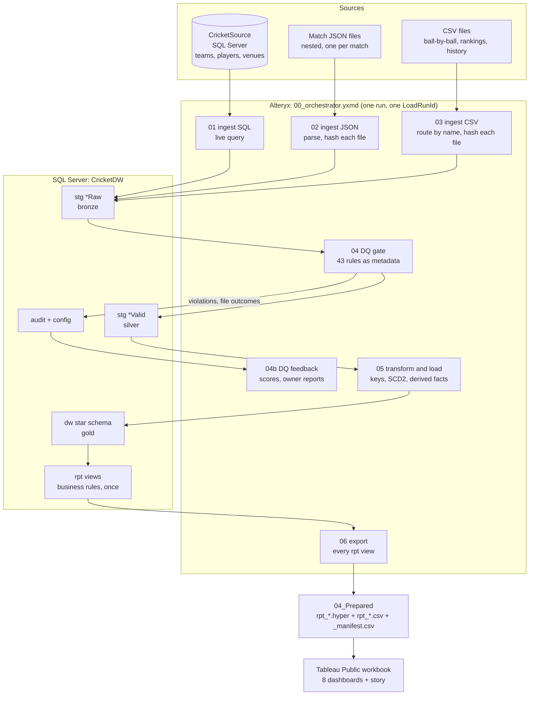

# Architecture and Data Flow

The solution as built: one Windows PC running SQL Server, Alteryx Designer and Tableau Public. The production
target is in `../production_architecture.md`; the two share everything up to the `rpt` views.

## Data flow

Every stage writes `Started` and `Succeeded` / `Failed` to `audit.Audit_ETLRunLog` through one shared macro. The
orchestrator runs each stage in its own Control Container that starts only if the previous stage logged no error,
so the export never runs against a half-loaded warehouse.

## Layers

| Layer | Where | Contents |
|---|---|---|
| Source | `CricketSource`, `02_SampleData/source/` | Master data (live), match JSON, CSV feeds |
| Bronze | `CricketDW.stg.*Raw` | Data as received, with source file, hash and run ID |
| Silver | `CricketDW.stg.*Valid` | Rows that passed the DQ gate, typed and standardised |
| Gold | `CricketDW.dw` | Star schema (`data_model/`) |
| Semantic | `CricketDW.rpt` | Views; every business calculation defined once |
| Serving | `04_Prepared/` | One `.hyper` extract (and CSV) per view, plus a manifest |
| Control | `CricketDW.audit`, `config` | Run log, file control, DQ exceptions and scores, rules, parameters |

## Key decisions

| Decision | Why |
|---|---|
| Two databases: `CricketSource` and `CricketDW` | The source system stays separate from what this project builds; each login is scoped to one database |
| SQL source read live; files tracked by content hash | Master data has no "file" to fingerprint; JSON / CSV are deliveries, so each is hashed: new → load, changed → reprocess, identical → skip, broken → reject with a reason |
| Data-quality rules are rows in `config.DQRule`, run inside SQL Server | Adding a rule is a data change, not a workflow change; every violation is logged to the exact row and rule |
| The match is the unit of acceptance | If one delivery of a match fails, or totals disagree with the scorecard, the whole match's ball-by-ball is held, so no dashboard shows a half-loaded match |
| One-transaction publish (`dw.usp_PublishWarehouse`) | Alteryx outputs commit separately; the procedure checks row counts and publishes all tables or none |
| Business rules only in `rpt` | Dashboards, exports and test queries compute every number the same way |
| Tableau reads `.hyper` extracts through relative paths | Tableau Public has no database connectors; the workbook opens from any clone with no setup |
| One orchestrator, run in Designer | One click for the whole pipeline; no command-line or machine path dependency |
