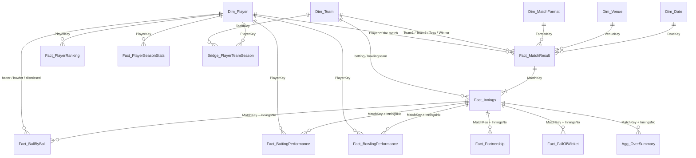

# Data Model

`CricketDW.dw` is a Kimball star schema: conformed dimensions, facts at declared grains, and one pre-aggregated
table. DDL: `01_Setup/sql/02_warehouse_schema.sql` and `08_warehouse_load_schema.sql`. All 36 foreign keys are
enforced and checked by `06_Tests/sql/check_referential_integrity.sql`.

## Star schema

## Tables and grains

| Table | Grain | Source | Note |
|---|---|---|---|
| `Dim_Date` | Day | Generated (`04_populate_dim_date.sql`) | `DateKey` yyyymmdd, season label |
| `Dim_Team` | Team **version** | SQL master + team name in each match file | Type-2: `EffectiveFrom` / `EffectiveTo` / `IsCurrent`; Delhi Falcons (2023) → Delhi Comets (2024) |
| `Dim_Player` | Player | SQL master | Role, batting / bowling style |
| `Dim_Venue`, `Dim_MatchFormat` | Venue, format | SQL master | |
| `Bridge_PlayerTeamSeason` | Player × team × season | Derived from scorecards | Transfers between seasons, without Type-2 churn on `Dim_Player` |
| `Fact_MatchResult` | Match | JSON | `ResultMethod` (Normal / Tied / SuperOver / NoResult / Abandoned), completeness flags |
| `Fact_Innings` | Team innings | JSON | Runs, wickets, overs, extras |
| `Fact_BallByBall` | Delivery | CSV | ~28,000 rows, every match |
| `Fact_BattingPerformance`, `Fact_BowlingPerformance` | Player × innings | Derived from ball-by-ball | |
| `Fact_Partnership`, `Fact_FallOfWicket` | Partnership / wicket per innings | Derived from ball-by-ball | |
| `Agg_OverSummary` | Over per innings | Derived from ball-by-ball | Pre-aggregated for run-rate charts (9x faster, see `performance.md`) |
| `Fact_PlayerRanking` | Player × format × date × discipline | CSV | Monthly snapshots |
| `Fact_PlayerSeasonStats` | Player × season × format | CSV | Historical-statistics feed |

## Modelling decisions

- **Type-2 for teams, bridge for players.** A team rename is attribute history of one entity, so `Dim_Team` keeps
  versions. A player moving between teams is a time-varying relationship, so it lives in a bridge table and
  `Dim_Player` stays one row per player.
- **Surrogate keys everywhere**, natural keys (`MatchId`, `PlayerCode`, `TeamCode`) kept as unique attributes, so
  a corrected match keeps its `MatchKey`.
- **Ball-level facts are derived, not loaded twice.** Batting, bowling, partnerships, fall of wickets and the over
  summary are computed from `Fact_BallByBall` in workflow `05`, so they always reconcile with it (tested).
- **Corrections replace whole sets.** A corrected match updates its row in place and replaces its ball-level facts
  inside one transaction (`dw.usp_PublishWarehouse`), which avoids orphaned rows when a correction adds or removes
  players.

## Around the star

| Schema | Holds |
|---|---|
| `stg` | Raw landing tables (`*Raw`), rows that passed the DQ gate (`*Valid`), load tables for the publish (`LoadReady_*`) |
| `audit` | `Audit_FileControl` (file hash and outcome), `Audit_DQException` (every rule violation), `Audit_ETLRunLog` (every stage start / end), DQ scores |
| `config` | `Parameter` (folder names, thresholds), `DQEntity` / `DQRule` (data-quality rules as metadata) |
| `rpt` | 22 reporting views and the business-rule functions (`business_rules.md`): the only layer reporting reads |
