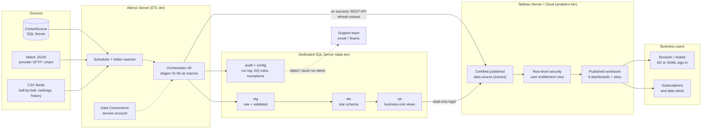

# Production Architecture

How this prototype becomes a production service with licensed **Alteryx Server**, a dedicated **SQL Server**, and
licensed **Tableau Server** (or Tableau Cloud), and how business users get to the dashboards.

Everything up to the `CricketDW.rpt` views stays as built. The `rpt` views are the contract between the
warehouse and every consumer; production changes only **who runs the pipeline**, **how Tableau gets the data**,
and **who may see what**.

## 1. Target architecture



| Tier | Prototype (this repo) | Production |
|---|---|---|
| ETL | Alteryx Designer, orchestrator run by hand | Alteryx Server: the same orchestrator, scheduled or triggered by a folder watcher |
| Credentials | Windows auth of the person running Designer | Service accounts in Alteryx Server Data Connections; nothing in workflow XML |
| Database | Local SQL Server Express, both databases | Dedicated SQL Server (Standard/Enterprise), backups, separate Dev / Test / Prod |
| Hand-off to Tableau | Workflow 06 writes `.hyper` files to `04_Prepared/` | Tableau connects to `CricketDW.rpt` with a read-only login; workflow 06 only triggers the refresh |
| Dashboards | Tableau Public, local file | Workbook published to a Tableau Server project |
| Access | Anyone with the file | AD / SAML sign-in, project permissions by AD group, row-level security |

## 2. Publishing the dashboards

1. **Connect.** In Tableau Desktop (Creator licence): Microsoft SQL Server → `CricketDW` → schema `rpt`, signed in
   as `cricket_rpt_reader` (already created by `01_Setup/sql/09_security.sql`). Relate the views on their keys
   (relationships, not joins), so each view keeps its own grain.
2. **Extract, full refresh.** The warehouse changes only when the pipeline runs, so an extract is as fresh as a
   live connection and puts no query load on SQL Server. Full refresh, because a corrected match replaces existing
   rows, which an append-only incremental refresh would miss.
3. **Publish the data source once**, separately from the workbook, to the project `Cricket Analytics / Data`, and
   mark it **Certified**. Embed the `cricket_rpt_reader` credential (or use a Run As service account), so end
   users never hold database credentials.
4. **Publish the workbook** (`05_Tableau/workbook/CricketAnalytics.twb`, re-pointed from the `.hyper` files to the
   published data source; field names are identical) to `Cricket Analytics / Dashboards`. Tabs shown as tabs, so
   the Season Story and every dashboard are one click apart.
5. **Promote** Dev → Test → Prod with the Tableau REST API or Content Migration Tool; each environment's data
   source points at that environment's `CricketDW`.

## 3. Refresh: event-driven, not on a timer

```mermaid
sequenceDiagram
    participant W as Folder watcher / schedule
    participant A as Alteryx Server (orchestrator)
    participant D as SQL Server (CricketDW)
    participant T as Tableau Server
    participant U as Users
    W->>A: new files or 06:00 schedule
    A->>D: stages 01-05 (one LoadRunId)
    alt every stage succeeded
        A->>T: REST API: refresh "Cricket Analytics" extract
        T-->>A: job id, then result
        A->>D: log refresh result as stage 06
        T->>U: dashboards show the new data; subscriptions sent
    else any stage failed
        A->>D: log Failed, stop
        A->>U: alert to support; dashboards keep the last good extract
    end
```

A timer-only Tableau schedule is rejected: it would refresh even after a failed load and show stale data under a
fresh "last refreshed" time. A weekly scheduled refresh stays as a safety net only.

## 4. How end users view the dashboards

| Who | Licence / site role | Can |
|---|---|---|
| Business users (coaches, analysts, management) | Viewer | Open dashboards in a browser or the Tableau Mobile app, filter, drill, subscribe, download PDF/image |
| Power users | Explorer | Also build their own views on the certified data source |
| BI team | Creator | Publish and change data sources and workbooks |

- **Sign-in** with company credentials (Active Directory / SAML single sign-on); no separate password.
- **Permissions** are set per project and granted to AD groups, never to individuals.
- **Row-level security:** a `rpt.UserEntitlement` view (user name → team, region) joined into the published data
  source with a `USERNAME()` filter, so a team analyst sees only their team. With the Data Management add-on, a
  virtual connection with a data policy is the stronger option.
- **Subscriptions and alerts** e-mail a dashboard after each refresh, or when a KPI crosses a threshold (for
  example a falling DQ pass rate).
- **Embedding:** the same views can be embedded in an intranet page with single sign-on.

## 5. Security and operations

| Area | Production control |
|---|---|
| Database access | The three least-privilege logins of the prototype, granted to roles mapped to AD groups; service accounts instead of passwords where possible |
| Secrets | Alteryx Server credential store and a vault for the Tableau personal access token; never in files or git |
| Network | SQL Server reachable only from the Alteryx and Tableau servers; Tableau Cloud reaches on-premises SQL Server through Tableau Bridge |
| Monitoring | Alteryx Server failure e-mails; a watchdog on `audit.vw_StuckRun`; Tableau failed-refresh alerts; DQ score trend on the Data Quality dashboard |
| Data-quality warnings | When a run's rejected-row rate passes a threshold, set a data-quality warning on the published data source (REST API) so every viewer sees it |
| Lineage | Tableau Catalog shows which dashboards use which `rpt` view, for impact analysis before a change |

## 6. What stays the same

Sources, ingestion (`01`–`03`), the data-quality gate (`04`, `04b`), the warehouse load (`05`), the
`stg → dw → rpt` layering, every business rule, the audit model and the least-privilege logins. The prototype is a
scaled-down version of this architecture, not a different one.
