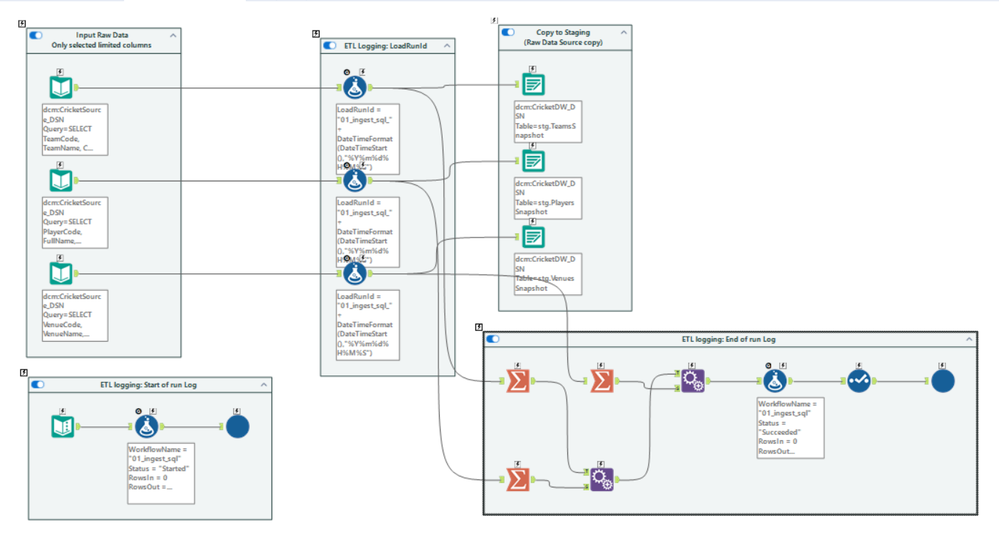
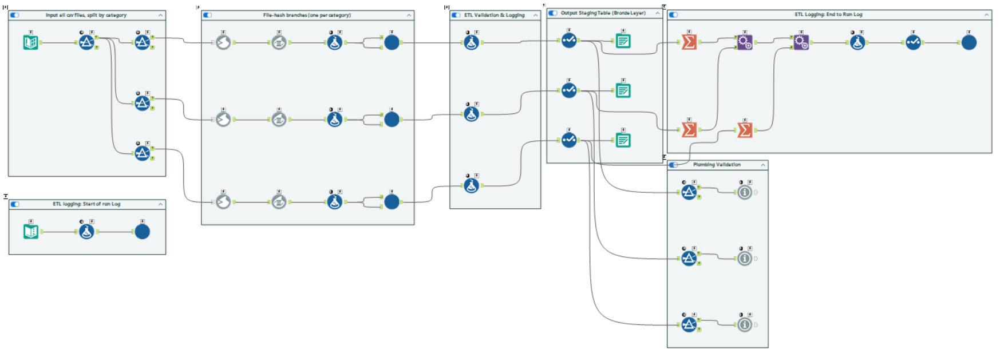

# Step 3 · Ingestion (Alteryx 01, 02, 03)

> **Intent:** land all three sources in staging exactly as received, with enough lineage (file, content hash,
> run ID) to trace every row back to where it came from.

**Files:** `03_Alteryx/workflows/01_ingest_sql.yxmc`, `02_ingest_json.yxmc`, `03_ingest_csv.yxmc`;
macros `Log_ETL_Event`, `Read_Deliveries`, `Read_PlayerRankings`, `Read_HistoricalStats`

## 01 · SQL master data

Reads `Teams`, `Players`, `Venues` live from `CricketSource` and writes a snapshot to `stg.*Snapshot`.
A live query, not a file: master data has no delivery to fingerprint, so its audit trail is the run log.

## 02 · Match JSON

1. **Directory** lists `*.json` in the inbox → **Blob Input** reads each file whole → **Blob Convert** to text.
2. **MD5 of the raw text** (`SourceFileHash`), taken *before* parsing, so it fingerprints the file itself.
3. **JSON Parse** flattens the nested document → **Cross Tab** back to one row per match and one per innings.
4. Writes `stg.MatchRaw` and `stg.InningsRaw` with file name, hash and `LoadRunId`.

## 03 · CSV feeds

1. **Directory** lists `*.csv`; three **Filters** route by name prefix (`deliveries`, `player_rankings`,
   `historical_stats`). Any other CSV is not read here and is rejected later as `schema_mismatch`.
2. One **batch macro** per category reads one file per iteration and tags its rows with that file's hash.
3. Writes `stg.BallByBallRaw`, `stg.PlayerRankingRaw`, `stg.HistoricalStatsRaw`.

## Why this way

- **Land first, judge later:** staging keeps every row as delivered (strings where the source is untrusted), so
  the data-quality gate can report on the original value.
- **Content hash, not file name**, identifies a delivery: a renamed copy is still a duplicate; a changed file
  with the same name is a correction.
- **One logging macro** (`Log_ETL_Event`) writes `Started` / `Succeeded` for every stage the same way.
- **Relative paths only** (`%Engine.WorkflowDirectory%\..\..\02_SampleData\_runtime\inbound`).

## Evidence

`audit.Audit_ETLRunLog` has `Started` and `Succeeded` rows per stage; `06_Tests/sql/check_reconciliation.sql`
proves source → staging counts match.
