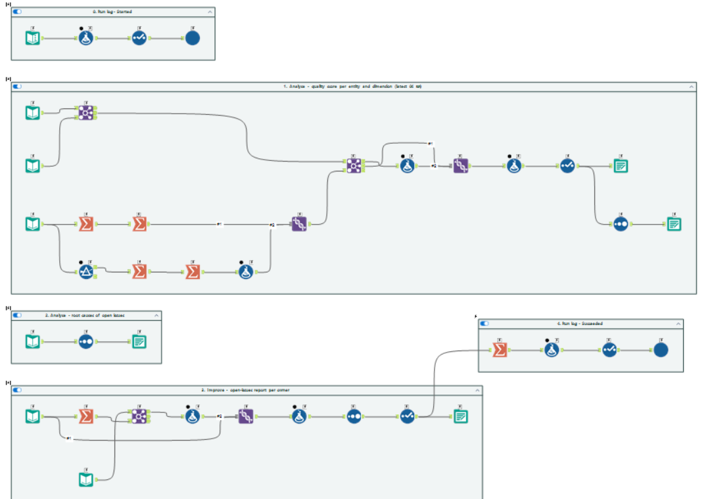

# Step 4 · Data-quality gate (Alteryx 04, 04b)

> **Intent:** nothing reaches the warehouse unchecked, nothing is dropped silently, and every problem has a
> rule, a reason and an owner.

**Files:** `03_Alteryx/workflows/04_dq_validation.yxmc`, `04b_dq_feedback.yxmc`, macro `DQ_RunRules.yxmc`;
rules in `01_Setup/sql/06_dq_metadata_schema.sql`. Full design: [`dq_approach.md`](../dq_approach.md).

## 04 · Validate

1. **Scope:** only files whose content hash has not been processed before (incremental); master data every run.
2. **Rules as metadata:** 43 rules in `config.DQRule`, each with a DQ dimension (completeness, validity,
   uniqueness, referential integrity, consistency, conformity), a SQL predicate, an action and an owner.
3. **Batch macro `DQ_RunRules`** runs each rule inside SQL Server and returns the violating rows.
4. **Actions:** `Rejected` (row kept out), `Flagged` (loaded with a warning), `Defaulted` (safe value applied, logged).
5. **The match is the unit of acceptance:** if one delivery fails, or deliveries disagree with the scorecard
   totals, the whole match's ball-by-ball is held, so no dashboard shows a half-loaded match.
6. **Outputs:** passing rows → `stg.*Valid`; every violation → `audit.Audit_DQException` (file, row, rule, raw
   value, action); every file → `audit.Audit_FileControl` (New / Reprocessed / Duplicate / Rejected).

## 04b · Feedback

Scores each run by entity and DQ dimension (`audit.DQRunScore`), tracks each issue's lifecycle (open → resolved),
and writes one open-issues CSV per data owner to `02_SampleData/_runtime/dq_reports/`.

## Why this way

- A new rule is a row of data, not a workflow change; the SQL engine evaluates rules set-based and fast.
- Logging the raw value and the rule gives full traceability from any dashboard number back to the source row.
- Owner reports close the loop: issues go back to whoever can fix them at the source.

## Evidence

Data Quality dashboard ([step 8](08_dashboards.md)); `06_Tests/sql/check_dq_run.sql`; every planted issue produces
its expected exception (`06_Tests/results/2026-10-05_dq_validation.md`).
