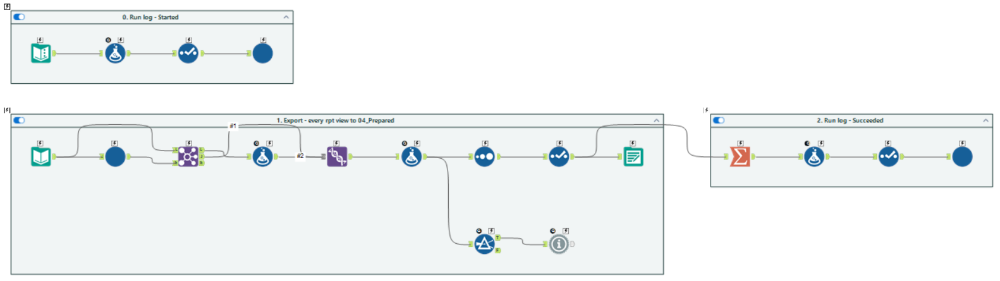

# Step 6 · Reporting layer and export (SQL `rpt` + Alteryx 06)

> **Intent:** define every business number once, and hand it to Tableau in a form any PC can open.

**Files:** `03_Alteryx/reporting_views/rpt_reporting_views.sql`, `03_Alteryx/workflows/06_export_reporting.yxmc`,
macro `Export_View.yxmc`. Rules: [`business_rules.md`](../business_rules.md).

## What it does

1. **22 `rpt` views** at the grain each dashboard needs (match, team × match, player × season, player × phase …),
   built on **business-rule functions** (`rpt.fn_BattingAverage`, `fn_StrikeRate`, `fn_Economy`, `fn_WinPct` …).
2. **Workflow 06** reads the list of views from the database and, per view (batch macro `Export_View`), writes
   `04_Prepared/rpt_<View>.hyper` (Tableau extract) and `.csv`, overwriting the previous run.
3. **Reconciles** rows written against each view's own count and writes `04_Prepared/_manifest.csv`
   (file, view, rows, run ID, time). A mismatch stops the run.

## Why this way

- **One definition per rule:** dashboards, exports and test queries all compute strike rate the same way.
  Ratios are exposed as their parts too, so Tableau re-aggregates `SUM(runs) / SUM(balls)` correctly.
- **A reporting login sees only `rpt`** (`security.md`); views are the contract between warehouse and reports.
- **`.hyper` through relative paths:** Tableau Public has no database connectors; extracts are fast and the
  workbook opens from any clone with no setup. A new view is exported with no workflow change.

## Evidence

For every view: rows in the `.hyper` = rows in the CSV = manifest count = `COUNT(*)` of the view
(`06_Tests/results/2026-10-06_export_orchestration.md`).
