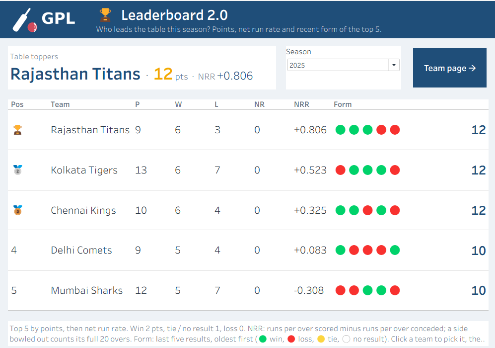
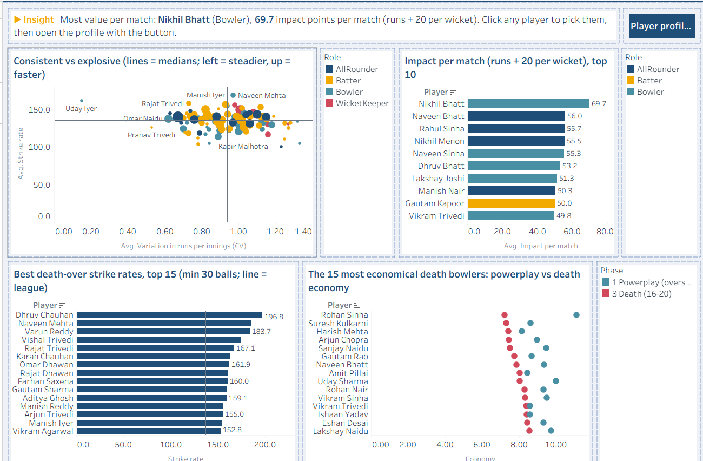
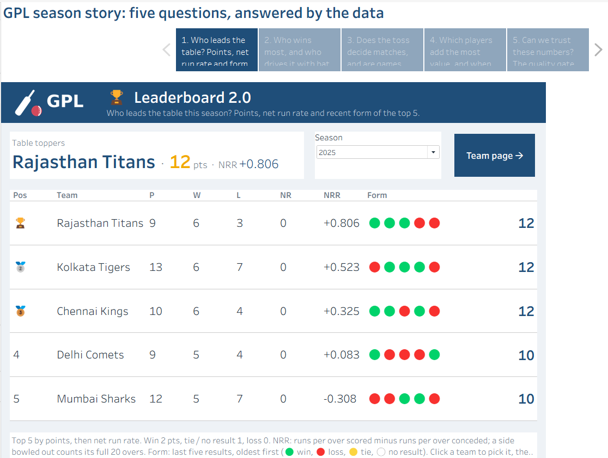

# Step 8 · Dashboards (Tableau)

> **Intent:** answer the business questions for people who make decisions, not people who read tables: lead
> with the conclusion, show whether a difference is real, and let them click through to the detail.

**Files:** `05_Tableau/workbook/CricketAnalytics.twb`.
Design rules: `05_Tableau/README.md`; decision rules: [`business_rules.md`](../business_rules.md#dashboard-decision-rules).

## Storytelling and decision-science techniques

| Technique | Example |
|---|---|
| **Insight sentence first**, computed from the data so it stays true after every refresh | "Most wins: Bangalore Royals, 20 of 29 decided matches (69%)" |
| **Benchmarks, not bare numbers** | Win % against a 50% coin-flip line; player strike rate against the same season's league average |
| **Is it real or chance?** | Toss and batting-first effects tested at 95% confidence; Team page says "clear edge" or "a lean, not a rule" |
| **Sample size always visible** | "wins of matches" labels; bars on fewer than 3 matches greyed out |
| **Context on every headline number** | Runs scored → average score; wickets → per innings; close finishes → "35 of 117" |
| **Competitive balance** | Close-finish rate (≤ 10 runs / ≤ 2 wickets / tie) overall and by season |
| **Turning points** | Match centre names the biggest and the most damaging over |
| **Guided path** | Click a team or player anywhere → button opens its page; the Season Story walks five findings in order |

## The dashboards

| Dashboard | Decision it supports |
|---|---|
|  **Overview** | Who wins, how teams trend by season, top performers, does the toss matter |
|  **Leaderboard 2.0** | Points table: position, net run rate, recent form |
|  **Team performance** | Form within and across seasons, head to head, venues, bat first or chase |
|  **Player profile** | Is the player above the league; runs, wickets and economy season by season; home vs away; by phase |
|  **Player leaderboards** | Consistent vs explosive, impact per match, death-over specialists, improving / declining |
|  **Match centre** | How one match unfolded: result, turning points, run worm, scorecards |
|  **Trends** | Are games getting closer, how results are decided, toss effects, scoring by phase, and how each ground plays (first-innings score, chase success) |
|  **Data quality** | Can the numbers be trusted: rows accepted, why rows failed, files rejected, owners |
|  **Season Story** | Five findings in order; doubles as the demo script |

## Why this way

- **One `.hyper` per reporting view**, read through relative paths: opens on any PC with no setup.
- **Workbook-wide pickers** (season, team, player, match) carry a choice across pages.
- **One template on every page:** header band, card layout, and a fixed colour per category value.

## Evidence

Dashboard numbers equal SQL for every checked figure (`06_Tests/results/2026-10-07_tableau_workbook.md`).
