

# 🏏 Cricket Analytics Platform

**End-to-end BI solution: raw cricket data from three sources → validated star schema → decision-ready dashboards**

[**Setup and run**](#-setup-and-run-step-by-step) · [**Add new data**](#-additional-challenge-add-new-data) · [**Assignment map**](#-assignment-map) · [**Pipeline**](#-pipeline-in-alteryx) · [**Dashboards**](#-dashboards) · [**Repository**](#-repository) · [**Presentation**](07_Docs/presentation/PriyanshiJani_Alteryx_Tableau_Assignment_CricketAnalytics_9Oct.pptx)

---

## 🎯 What it does

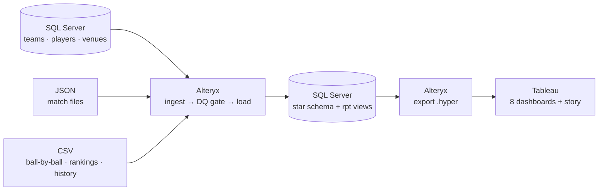

| | |
|---|---|
| **3 sources** | Live SQL master data, nested JSON matches, CSV feeds (120 matches, 3 seasons, ~28,000 deliveries) |
| **43 data-quality rules** | Stored as data, run in SQL Server, every violation traced to the row, rule and owner |
| **1 click** | One Alteryx orchestrator runs all 7 stages and stops safely on any failure |
| **1 definition per metric** | Business rules live once, in SQL reporting views |
| **8 dashboards** | Insight sentences, benchmarks and significance tests, not just charts |

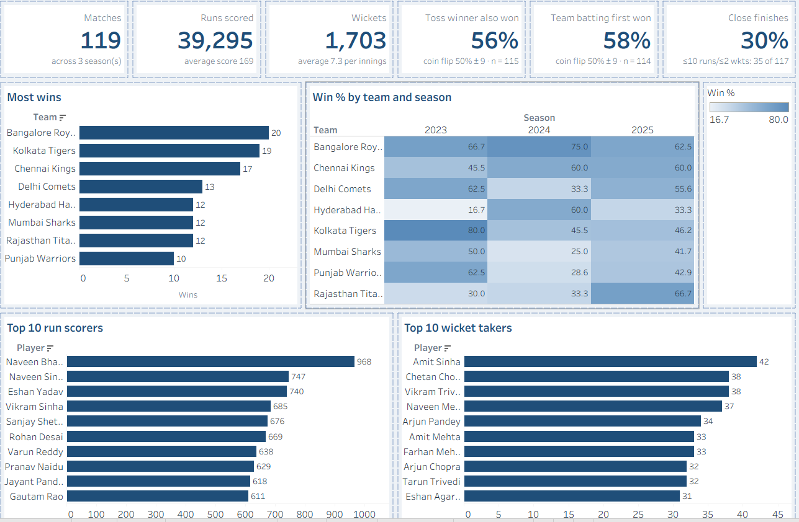

---

## 🚀 Setup and run, step by step

Follow the steps in order. The SQL Server instance is typed **once** (step 4); everything else reads it.
Each step's detail and troubleshooting: **[07_Docs/deployment.md](07_Docs/deployment.md)**.

### Part A · Install (once)

| Step | Install | Where | Note |
|---|---|---|---|
| 1 | **SQL Server Express** 2019+ | [microsoft.com/sql-server](https://www.microsoft.com/en-us/sql-server/sql-server-downloads) | *Basic* install. Note the instance name (usually `SQLEXPRESS`). Brings `sqlcmd` and the ODBC driver |
| 2 | **Alteryx Designer** 2026.2+ · **Tableau Public** 2026.2+ | [Alteryx free trial](https://www.alteryx.com/designer-trial) · [Tableau Public](https://www.tableau.com/products/public/download) | Both free (Alteryx: 30-day trial) |
| 3 | **Git** and **Python** 3.10+ | [git-scm.com](https://git-scm.com/download/win) · [python.org](https://www.python.org/downloads/) | Python runs one setup script (standard library only) |

### Part B · Configure this PC (once)

| Step | Do | File / location | You should see |
|---|---|---|---|
| 4 | Clone the repository, then run the prerequisite check. Open the file it creates and set `SQL_INSTANCE` (e.g. `localhost\SQLEXPRESS`) | `git clone https://github.com/priyanshijani/CricketAnalytics.git` → `01_Setup\check_prerequisites.bat` → `config\local.config` | `[NEW] Created config\local.config` |
| 5 | Run the prerequisite check again | `01_Setup\check_prerequisites.bat` | Every line `[OK]`, including `Connected to …` |
| 6 | Create both databases and seed the source system | `01_Setup\setup_database.bat` | `Database setup complete.` |
| 7 | Create the two ODBC data sources — right-click → **Run as administrator** | `01_Setup\create_odbc_dsns.bat` | Two `[OK]` lines: `CricketSource_DSN`, `CricketDW_DSN` |
| 8 | In Alteryx Designer: **File → Manage Connections → New Connection** (*Microsoft SQL Server ODBC*, authentication *No Credentials*), twice: `CricketSource_DB` on DSN `CricketSource_DSN`, `CricketDW_DB` on DSN `CricketDW_DSN`. Close Designer | Alteryx Designer | *Test Connection* succeeds for both |
| 9 | Point every workflow at those two connections | `python 03_Alteryx\relink_connections.py` | `[OK]` for both connections; `11 of 14 … relinked` |

> Why step 8 is manual: Alteryx 2026.2 accepts only connections saved in Designer's own store. Each connection only
> names a DSN from step 7, so no server name or password is typed there.

> [!CAUTION]
> **About step 9.** Run it with Designer closed. If a workflow was open, close it *without saving*, or the old
> connection IDs come back and the run fails with *Selected Connection is not available*.
> Afterwards `git status` lists **11 changed workflow files**: that is expected on every PC (only the connection IDs
> changed). **Do not commit them.** Re-run step 9 whenever you recreate an Alteryx connection.

### Part C · Run the pipeline and open the dashboards

| Step | Do | File / location | You should see |
|---|---|---|---|
| 10 | Stage the source files into the pipeline's inbox | `02_SampleData\stage_source_files.bat` → `02_SampleData\_runtime\inbound\` | `Done. Files staged` |
| 11 | Close Tableau. Open the orchestrator in Designer and press **Run** | `03_Alteryx\workflows\00_orchestrator.yxmd` | No errors; `02_SampleData\_runtime\run_summary_latest.csv` lists every stage `Succeeded` |
| 12 | Open the workbook in Tableau Public | `05_Tableau\workbook\CricketAnalytics.twb` | **Overview** shows **119** matches |
| 13 | *(optional)* Run the automated checks | `06_Tests\run_sql_tests.bat` | Results in `06_Tests\results\` |

---

## ➕ Additional challenge: add new data

Every pass is the same three steps; no reporting data is prepared by hand.

| Step | Do | File / location | You should see |
|---|---|---|---|
| 14 | Put the new data in place: **one** option from the table below | see below | — |
| 15 | Close Tableau, then run the orchestrator in Designer | `03_Alteryx\workflows\00_orchestrator.yxmd` | No errors |
| 16 | Reopen the workbook | `05_Tableau\workbook\CricketAnalytics.twb` | The change (expected values below) |

| Option | How | Where |
|---|---|---|
| **A · Ready-made scenarios** | Double-click `02_SampleData\stage_demo_change.bat` and enter **1** to **4**: `new_matches`, then `corrected_files`, `duplicate_files`, `malformed_files` — one per pass. From a prompt: `stage_demo_change.bat new_matches` | Files: `02_SampleData\source\demo_changes\` |
| **B · Your own files** | Copy into the inbox. A match: any `.json` ([JSON schema](02_SampleData/source/json/JSON_SCHEMA.md), copy one from `02_SampleData\source\json\matches\` as a template). CSV names must start with `deliveries`, `player_rankings` or `historical_stats` ([CSV schema](02_SampleData/source/csv/CSV_SCHEMA.md)) | `02_SampleData\_runtime\inbound\` |
| **C · New master data** | Insert teams, players or venues into `CricketSource` (SSMS or `sqlcmd`); the next run reads it live. [Examples](07_Docs/deployment.md#d-add-new-or-changed-data) | SQL Server `CricketSource.dbo` |

Codes used in new files must exist in `CricketSource`; anything that breaks a rule is rejected with its reason on the
**Data Quality** dashboard, never silently dropped.

**Expected changes for Option A.** "Before" is the baseline run (step 12); each "After" assumes the scenarios above it ran.

| Scenario | Data point | Dashboard | Before | After |
|---|---|---|---|---|
| **1. New match** `M0121` (2025, MUM 147/5 v CHE 148/9, Chennai won by 1 wicket) | Matches | Overview (All seasons) | 119 | **120** |
| | Runs scored · Wickets | Overview | 39,295 · 1,703 | **39,590 · 1,717** |
| | Close finishes | Overview | 30% (35 of 117) | **31% (36 of 118)** |
| | Chennai Kings wins | Overview → Most wins | 17 | **18** |
| | 2025 table topper | Leaderboard (2025) | Rajasthan Titans, 12 pts | **Chennai Kings, 14 pts** |
| | Mumbai Sharks, 2025 | Leaderboard (2025) | P 12 · W 5 · L 7 · 10 pts | **P 13 · W 5 · L 8 · 10 pts** |
| | Match `M0121` | Match centre (pick `M0121`) | not in the list | **Listed, with run worm and scorecards; turning points "CHE over 4, 17 runs" and "CHE over 9, 2 wkts for 5 runs"** |
| **2. Corrected file** `M0031` (2023: Mumbai's chase re-scored) | M0031 result | Match centre (pick `M0031`) | Delhi Falcons won by 31 runs · MUM 134/10 | **Mumbai Sharks won by 4 wickets · MUM 168/6** |
| | Wins: Delhi Comets · Mumbai Sharks | Overview → Most wins | 13 · 12 | **12 · 13** |
| | Points 2023: DEL · MUM | Leaderboard (2023) | 10 · 10 | **8 · 12** (Delhi drops out of the top 5) |
| | Runs scored · Wickets | Overview | 39,590 · 1,717 | **39,624 · 1,713** |
| | M0031 ball by ball | Match centre | run worm and scorecards | **empty**: old deliveries no longer match the corrected score, so they are held back |
| **3. Duplicate file** `M0051` (identical re-send) | Every number above | All | — | **unchanged** |
| | M0051 | Data Quality → files by outcome | — | **logged as a duplicate; nothing reprocessed** |
| **4. Malformed files** (broken JSON, JSON without match ID, CSV with wrong columns) | Files rejected | Data Quality | 4 | **7** |
| | Rejected files list | Data Quality | 4 files | **+ `M0999_broken.json`, `M0998_missing_identity.json`, `MALFORMED_deliveries_wrong_schema.csv`**, each with its reason |
| | Every other number | All | — | **unchanged**: the rest of the run completes |

---

## 🧭 Assignment map

Where each section of the brief is answered.

| Brief § | Topic | Where to look |
|---|---|---|
| 2 | Business questions | Dashboards (below) · additional questions: [`07_Docs/00_Project_Plan.md` §3](07_Docs/00_Project_Plan.md#3-business-questions) |
| 3 | Source data: SQL Server, JSON, CSV | [`02_SampleData/source/`](02_SampleData/source/README.md) · [JSON schema](02_SampleData/source/json/JSON_SCHEMA.md) · [CSV schema](02_SampleData/source/csv/CSV_SCHEMA.md) · [planted issues](02_SampleData/source/DATA_QUALITY_ISSUES.md) |
| 4–5 | Architecture, data flow, data model, business rules | [`07_Docs/architecture/`](07_Docs/architecture/README.md) · [`07_Docs/data_model/`](07_Docs/data_model/README.md) · [`07_Docs/business_rules.md`](07_Docs/business_rules.md) · [`07_Docs/solution_overview.md`](07_Docs/solution_overview.md) |
| 6 | Data quality | [`07_Docs/dq_approach.md`](07_Docs/dq_approach.md) · rules: [`01_Setup/sql/06_dq_metadata_schema.sql`](01_Setup/sql/06_dq_metadata_schema.sql) · **Data Quality** dashboard |
| 7 | Reliability, error handling, logging | [`07_Docs/steps/07_orchestration.md`](07_Docs/steps/07_orchestration.md) · [troubleshooting](07_Docs/deployment.md#troubleshooting) |
| 8–9 | Analytics and visualisation | [`07_Docs/steps/08_dashboards.md`](07_Docs/steps/08_dashboards.md) · [`05_Tableau/`](05_Tableau/README.md) |
| 10 | Performance | [`07_Docs/performance.md`](07_Docs/performance.md) |
| 11 | Security | [`07_Docs/security.md`](07_Docs/security.md) · [`01_Setup/sql/09_security.sql`](01_Setup/sql/09_security.sql) |
| 12 | Deployment | [`07_Docs/deployment.md`](07_Docs/deployment.md) · production: [`07_Docs/production_architecture.md`](07_Docs/production_architecture.md) |
| 13 | Testing and validation | [`06_Tests/`](06_Tests/README.md) · [traceability matrix](06_Tests/traceability_matrix.md) · [latest results](06_Tests/results/2026-10-07_full_test_run.md) |
| 14 | Deliverables | Solution: this repository · SQL: [`01_Setup/sql/`](01_Setup/sql/README.md), [`03_Alteryx/reporting_views/`](03_Alteryx/reporting_views/README.md) · Alteryx: [`03_Alteryx/`](03_Alteryx/README.md) · Tableau: [`05_Tableau/workbook/`](05_Tableau/workbook/README.md) · Docs: [`07_Docs/`](07_Docs/README.md) · Presentation: [`07_Docs/presentation/`](07_Docs/presentation/README.md) |
| 16 | Additional challenge | [Add new data](#-additional-challenge-add-new-data) (above) |

---

## 🔧 Pipeline in Alteryx

One orchestrator runs every stage in order; each stage starts only if the previous one succeeded.

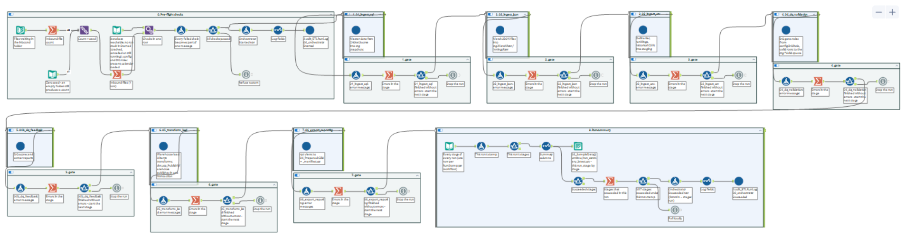

| Stage | Workflow | What it does |
|---|---|---|
| 01 | `03_Alteryx/workflows/01_ingest_sql.yxmc` | Master data from `CricketSource` into staging |
| 02 | `03_Alteryx/workflows/02_ingest_json.yxmc` | Match files: fingerprint, parse nested JSON, flatten |
| 03 | `03_Alteryx/workflows/03_ingest_csv.yxmc` | CSV feeds: route by file name, read each file |
| 04 | `03_Alteryx/workflows/04_dq_validation.yxmc` | Data-quality gate: 43 rules run in SQL Server |
| 04b | `03_Alteryx/workflows/04b_dq_feedback.yxmc` | Quality scores and a report per data owner |
| 05 | `03_Alteryx/workflows/05_transform_load.yxmc` | Star schema, published in one transaction |
| 06 | `03_Alteryx/workflows/06_export_reporting.yxmc` | Every reporting view to a Tableau extract |

| | | |
|:---:|:---:|:---:|
| 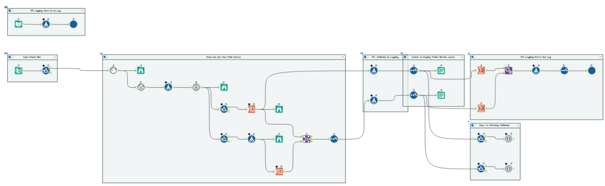 **Ingest JSON** | 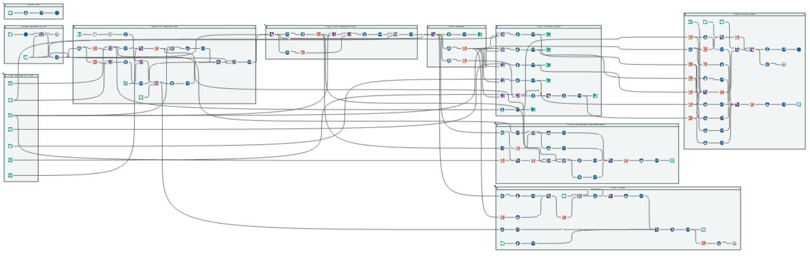 **Data-quality gate** | 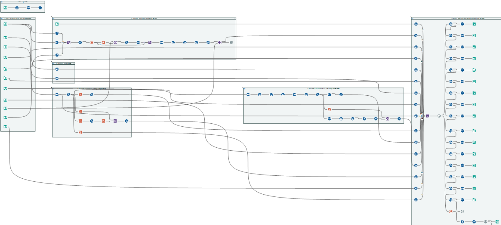 **Warehouse load** |

Step-by-step walkthrough: [`07_Docs/steps/`](07_Docs/README.md#how-it-was-built-step-by-step).

---

## 📊 Dashboards

| | | |
|:---:|:---:|:---:|
|  **Overview** | 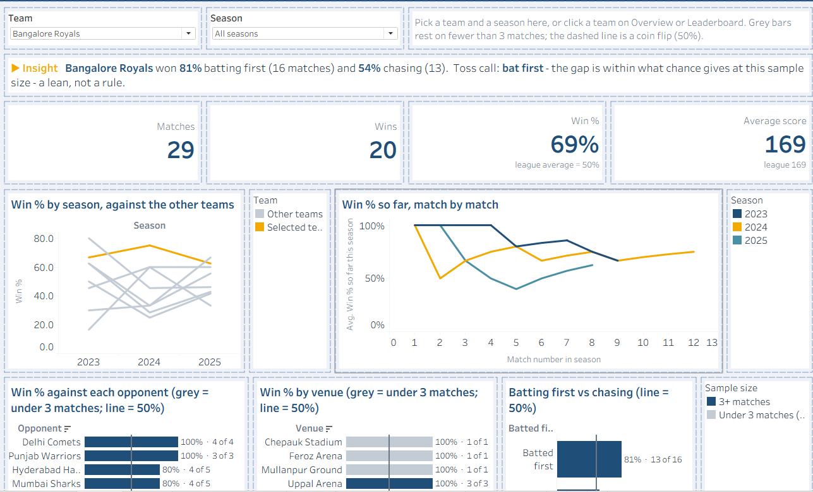 **Team** | 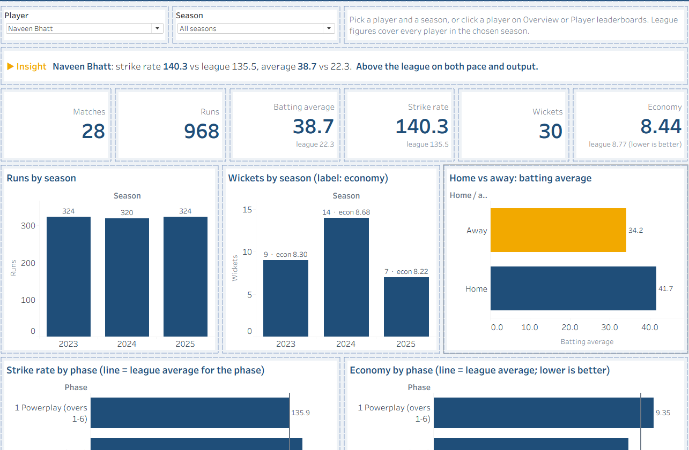 **Player** |
| 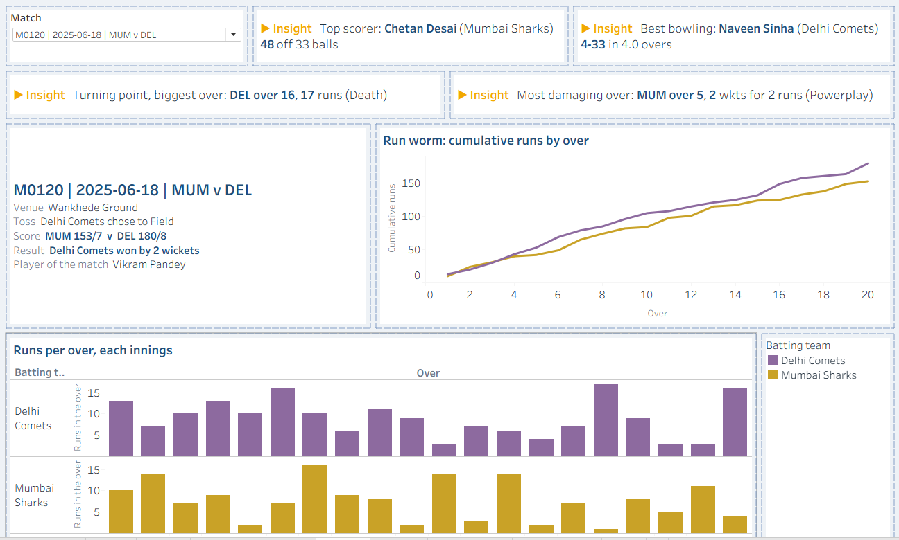 **Match centre** | 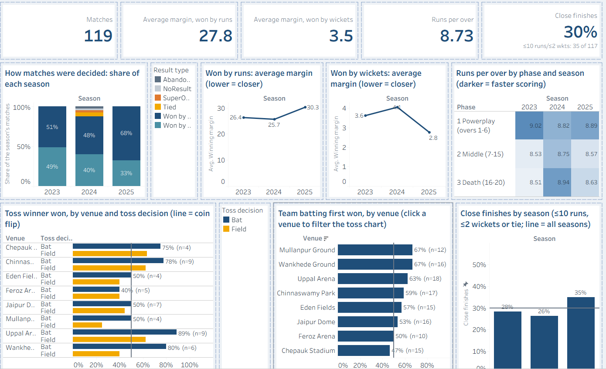 **Trends** | 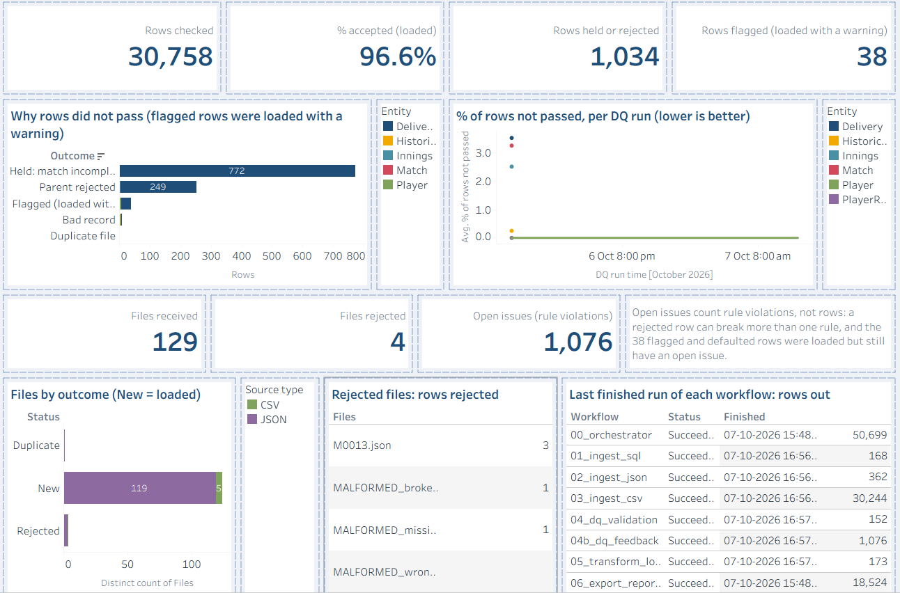 **Data quality** |

Every page opens with an **insight sentence computed from the data**, compares against a **benchmark** (league
average, 50% coin flip), says whether a difference is **real or chance** (95% test), and shows the **sample size**.
Click a team or player anywhere to open its page. → [How and why](07_Docs/steps/08_dashboards.md)

---

## 📁 Repository

Folders are numbered in the order you use them.

| Folder | Contents | Start with |
|---|---|---|
| [`01_Setup/`](01_Setup/README.md) | Prerequisite check, database setup, ODBC data sources, SQL DDL (`sql/`) | `check_prerequisites.bat` |
| [`02_SampleData/`](02_SampleData/README.md) | Source data (SQL seed, JSON, CSV), Additional-challenge files, staging scripts, data generator | `stage_source_files.bat` |
| [`03_Alteryx/`](03_Alteryx/README.md) | Orchestrator, seven stage workflows, shared macros, reporting views | `workflows/00_orchestrator.yxmd` |
| [`04_Prepared/`](04_Prepared/README.md) | Extracts the dashboards read (`.hyper` + `.csv` + `_manifest.csv`) | — (written by the pipeline) |
| [`05_Tableau/`](05_Tableau/README.md) | Tableau workbook: 8 dashboards and a story | `workbook/CricketAnalytics.twb` |
| [`06_Tests/`](06_Tests/README.md) | SQL test suites, test cases, results, traceability | `run_sql_tests.bat` |
| [`07_Docs/`](07_Docs/README.md) | Architecture, data model, rules, DQ, security, performance, deployment, step-by-step guides, presentation | `README.md` |
| [`config/`](config/README.md) | Local configuration template | `local.config.example` |
